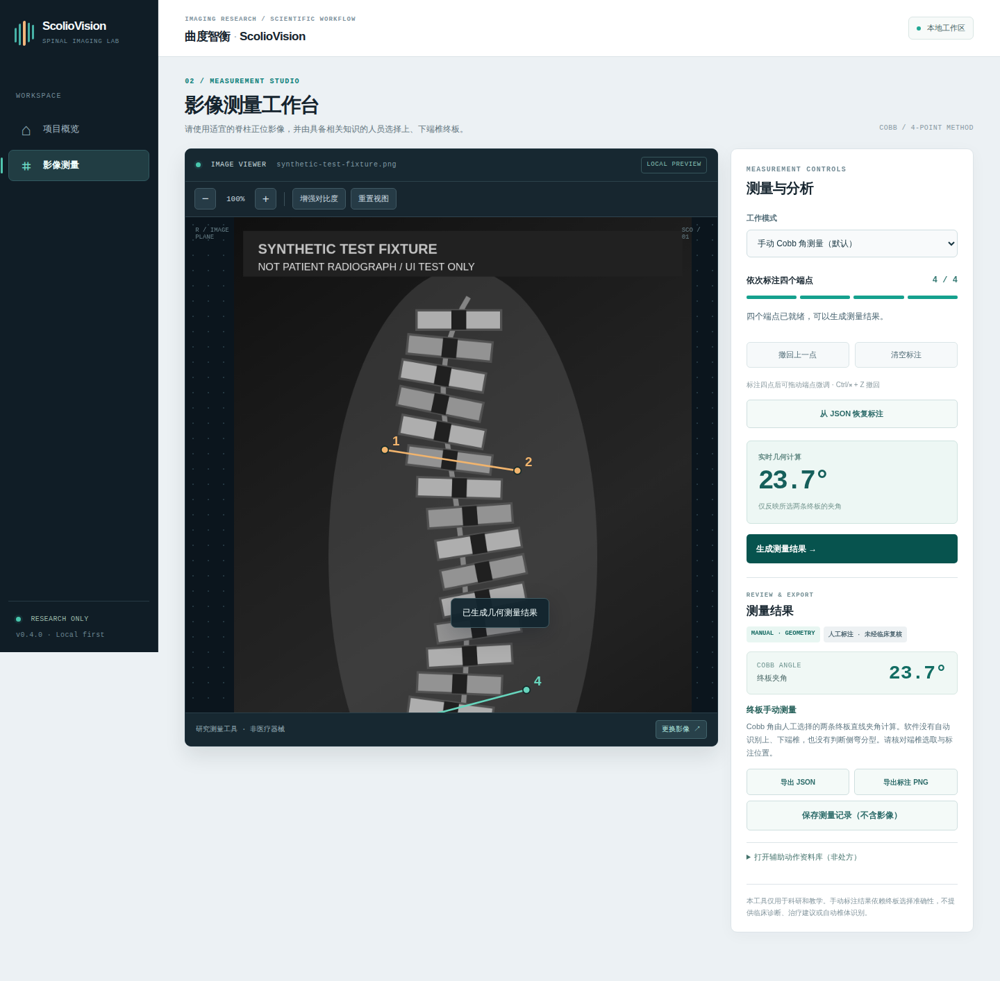
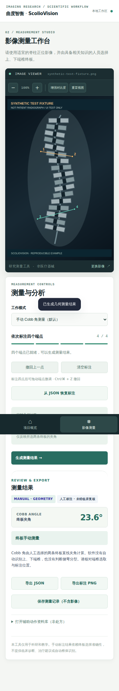
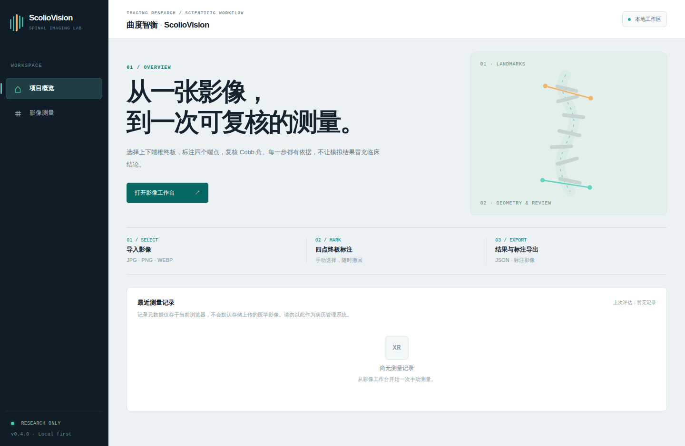

# ScolioVision · 曲度智衡

> **Research-oriented scoliosis imaging analysis and rehabilitation interaction system**  
> **面向脊柱侧弯影像分析与康复交互的科研型软件系统**

[English](#english) · [中文](#中文) · [Architecture](docs/ARCHITECTURE.md) · [Research Protocol](docs/RESEARCH_PROTOCOL.md) · [API Contract](docs/API_CONTRACT.md)

---

## Release v0.5.0 / 版本说明

**Current default: user-selected four-point Cobb-angle geometry (no automatic detection).** Select the superior and inferior endplate endpoints in the image viewer. Undo, zoom, local JSON/PNG exports, and metadata-only local history are supported. Synthetic demo values are isolated behind an explicitly labelled mode; they are **not medical measurements**. The interface is a research prototype, not a medical device.

**当前默认：人工四点终板标注 + 几何 Cobb 角计算；支持端点拖动微调与已导出 JSON 的恢复。** 可撤回标注、缩放影像、导出 JSON/PNG，并仅保存不含影像的历史元数据。模拟推理必须手动选择，不能用于临床。每次版本升级合并至 main 后，GitHub Actions 自动构建并创建附带静态网页 ZIP 的 Release。

**v0.5.0 workstation redesign:** The app now opens in the measurement viewer. A consistent radiology-inspired shell, dark image viewport, four-stage workflow rail, file/resolution status, accessible controls, and shortcut zoom (+ / − / 0) keep attention on image annotation. Appearance is not evidence of medical validation.

**v0.5.0 医学影像工作台视觉重构：** 默认进入影像测量；新增四阶段流程状态、暗色影像查看器、原图尺寸信息、快捷键缩放、统一的控制台与移动端布局。保持人工四点计算逻辑与研究用途边界，不借界面外观暗示临床认证。

[Download Releases / 下载构建包](https://github.com/ZJY-HSBL/ScolioVision/releases)

---

## Prototype UI / 原型界面

> The screenshots below are captured from the actual built web application using an automated browser, with **synthetic test fixtures**. They contain no patient images and do not represent clinical validation.
> 下图由自动化浏览器对真实构建的网页应用截图，测量示例使用**合成测试图像**，不包含患者影像，也不代表临床验证。

| Desktop / 桌面工作台 | Mobile / 移动适配 |
|:--:|:--:|
|  |  |



Screenshots are generated by `web/scripts/capture-ui.cjs` using Chromium and refreshed with each interface release.

---

## English

### Overview

**ScolioVision** is a research-oriented software system for scoliosis imaging workflows. It integrates radiograph input, local image preprocessing, inference-service integration, structured result presentation, analysis-history management, and rehabilitation-content interaction into a unified framework.

The system adopts a modular architecture so that image processing, inference services, result schemas, user interaction, and rehabilitation content can evolve independently. It can operate with the built-in reproducible workflow engine or connect to an external model service through a standardized inference interface.

### Key Features

- Professional workstation layout with image-first launch, structured workflow status, resolution indicator, keyboard zoom (+, -, 0), and a compact measurement inspector.
- No patient identity/clinical status is invented by the UI; remote processing and synthetic inference retain explicit labels.
- Editable landmark handles, keyboard undo, schema-validated measurement JSON import and matching-image checks.
- Desktop and mobile screenshots taken from the real app, using synthetic test fixtures.


- Radiograph upload with JPG, PNG, and WEBP support.
- Local image validation, compression, and preview.
- Modular inference-service adapter.
- Structured output for curve type, Cobb-angle field, result band, source, and input fingerprint.
- Local analysis-history management.
- Rehabilitation exercise library with integrated training videos.
- Responsive mobile/desktop interface.
- Standardized API contract for Python, PyTorch, ONNX, Flask, FastAPI, and related model services.
- Bilingual research and engineering documentation.

### System Architecture

```text
Radiograph / Image
        │
        ▼
Local Validation & Preprocessing
        │
        ▼
Inference Service
   ├── Built-in reproducible workflow engine
   └── External model service
        │
        ▼
Structured Analysis Result
        │
        ├── Result Visualization
        ├── Analysis History
        └── Rehabilitation Content
```

### Quick Start

```bash
git clone https://github.com/ZJY-HSBL/ScolioVision.git
cd ScolioVision/web
npm ci
npm run dev
```

Production build:

```bash
npm run build
```

Project verification:

```bash
npm run check
npm test
```

### Model Integration

Inference configuration is located in `web/js/config.js`.

```js
analysisMode: 'remote',
apiEndpoint: 'https://your-backend.example.com/inference'
```

The request/response schema is documented in `docs/API_CONTRACT.md`.

### Research Directions

ScolioVision supports research extensions including vertebral landmark localization, endplate detection, end-vertebra selection, automatic Cobb-angle estimation, scoliosis curve-pattern classification, image-quality control, external validation, and longitudinal follow-up analysis.

For Cobb-angle estimation, suitable metrics include MAE, RMSE, tolerance-band accuracy, ICC where appropriate, and Bland–Altman analysis. Classification components may report Precision, Recall, F1-score, confusion matrices, and calibration metrics.

### Research Use

ScolioVision provides a software platform for scoliosis-imaging research, algorithm integration, model-service validation, and interaction-system development. Formal medical research or clinical deployment should use appropriate datasets, ethical procedures, clinical supervision, and independently evaluated models.

---

## 中文

### 项目简介

**ScolioVision（曲度智衡）** 是一套面向脊柱侧弯影像分析与康复交互的科研型软件系统。项目围绕影像输入、本地图像预处理、推理服务、结构化结果展示、分析历史管理和康复内容交互构建完整的软件工作流，为脊柱侧弯自动评估及相关计算机视觉研究提供统一的软件基础。

系统采用模块化架构，将图像处理、推理服务、结果数据结构、前端交互和康复内容相互解耦，可灵活接入关键点检测、终板检测、图像分割、角度估计及其他深度学习模型。

### 核心功能

- 支持 JPG、PNG、WEBP 格式的脊柱影像上传；
- 图像本地校验、压缩与预览；
- 独立推理服务适配层；
- Cobb 角、侧弯类型等结构化结果展示；
- 推理来源、输入指纹与结果区间管理；
- 本地分析历史记录；
- 康复动作交互库与训练视频；
- 移动端与桌面端响应式界面；
- 支持 Python、PyTorch、ONNX、Flask、FastAPI 等模型服务接入；
- 中英文科研与工程文档。

### 系统架构

```text
脊柱影像
   │
   ▼
本地校验与预处理
   │
   ▼
推理服务层
   ├── 内置可复现工作流
   └── 外部模型服务
   │
   ▼
结构化分析结果
   │
   ├── 结果可视化
   ├── 分析历史
   └── 康复内容交互
```

### 快速运行

```bash
git clone https://github.com/ZJY-HSBL/ScolioVision.git
cd ScolioVision/web
npm install
npm run dev
```

生产构建：

```bash
npm run build
```

项目检查：

```bash
npm run check
```

### 模型接入

推理配置位于 `web/js/config.js`：

```js
analysisMode: 'remote',
apiEndpoint: 'https://your-backend.example.com/inference'
```

前后端数据格式统一定义于 `docs/API_CONTRACT.md`。

### 科研方向

ScolioVision 可进一步用于椎体关键点定位、椎体终板检测、上下端椎自动识别、Cobb 角自动测量、脊柱侧弯模式分类、医学影像质量控制、模型误差分析、外部验证以及患者纵向随访与趋势可视化等研究方向。

Cobb 角测量研究可采用 MAE、RMSE、误差阈值内比例、ICC（适用时）以及 Bland–Altman 分析等指标；分类任务可使用 Precision、Recall、F1-score、混淆矩阵以及概率校准指标。

### 研究使用

ScolioVision 可用于脊柱侧弯影像科研实验、算法集成、模型服务验证与交互系统开发。正式医学研究或临床应用应结合规范的数据、伦理流程、专业临床指导和经过独立评估的模型。

---

If you use this repository in research or software development, citation metadata is available in `CITATION.cff`.
